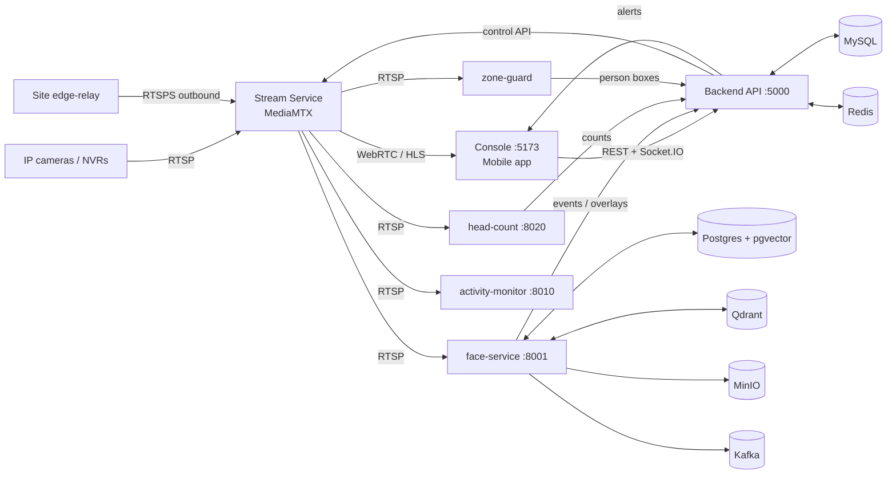

# Drishyam — AI Video Management System

Multi-tenant VMS with built-in video analytics: live view (WebRTC / HLS),
recording and playback, NVR integration, face recognition and watchlists,
cross-camera person journey, footfall and head count / occupancy, restricted
zones, activity monitoring, alerts (in-app, e-mail, mobile push) and reports.
Runs on one NVIDIA GPU host with Docker, in the cloud or on-premise.

This folder is a clean, self-contained copy of the working system (snapshot
2026-11-06): all source, every AI model weight, database schema, deployment
tooling and documentation. Nothing outside this folder is needed except
Docker images pulled from public registries. What was verified, what was left
out and why: [docs/SNAPSHOT_NOTES.md](docs/SNAPSHOT_NOTES.md).

## Quick start

```bash
git lfs install && git lfs pull      # weights + demo videos are LFS (see .gitattributes)
cp .env.example .env                 # SERVICE_TOKEN=$(openssl rand -hex 32), HOST_IP for LAN access
cp backend/.env.example backend/.env # JWT_SECRET / JWT_REFRESH_SECRET / CAMERA_CRED_KEY
docker compose up -d --build         # first build ≈ 15-30 min, first AI boot ≈ 5 min
# smaller GPU / UI only: docker compose up -d mysql redis stream-service smart-cam-backend smart-cam-app

docker compose exec -e ADMIN_EMAIL=you@example.com -e ADMIN_PASSWORD='choose-a-strong-one' \
  smart-cam-backend node scripts/create-admin.js
```

Open **http://localhost:5173**, sign in, add a camera (or `--profile demo`
for a looped test camera). Full walkthrough, prerequisites and production
hardening: **[docs/SETUP.md](docs/SETUP.md)**. On Windows, use Docker Engine
inside WSL2 Ubuntu, not Docker Desktop (step-by-step in SETUP.md §1).

MinIO runs from `bitnamilegacy/minio:2024.10.13` because the official
`minio/minio` image can no longer be pulled. It's already set in
`docker-compose.yml`, so there's nothing to do.

| URL | What |
|---|---|
| http://localhost:5173 | operator console (`/admin` for the platform console) |
| http://localhost:5000/api/health/live | backend health |
| http://localhost:9001 | MinIO console |

## Layout

| Folder | What it is |
|---|---|
| [`backend/`](backend/) | Node 20 / Express API — the control plane: auth, tenants, cameras, NVRs, recordings, alerts, reports, licences. MySQL via Sequelize (`migrations/`, `seeders/`). Jest tests in `test/`. |
| [`frontend/`](frontend/) | React 19 + Vite operator console (Live View, Monitor Wall, Playback, AI pages, Reports, Admin console at `/admin`). |
| [`mobile/`](mobile/) | React Native + Expo mobile app (live wall, alerts, push). |
| [`ai/face-service/`](ai/face-service/) | `vms_face` (Python, FastAPI): face detection + recognition, watchlist, person journey, footfall, inference server, match + stitch workers. Postgres/pgvector + Qdrant + MinIO + Kafka. |
| [`ai/head-count/`](ai/head-count/) | Head-count / occupancy service (YOLOv8 head detector), :8020. |
| [`ai/zone-guard/`](ai/zone-guard/) | Restricted-zone person detection (YOLOv8 person boxes → backend zone engine). |
| [`ai/activity-monitor/`](ai/activity-monitor/) | Phone-use / working / attendance analytics (pose + phone detector), :8010. |
| [`ai/face-reconstruct/`](ai/face-reconstruct/) | Forensic face enhancement (CodeFormer + Real-ESRGAN), optional. |
| [`media/stream-service/`](media/stream-service/) | Drishyam Stream Service (MediaMTX 1.18.1): RTSP ingest, WebRTC/HLS egress, recording. |
| [`media/transcoder/`](media/transcoder/), [`media/sfu-bridge/`](media/sfu-bridge/) | Optional: per-camera NVENC normaliser; LiveKit SFU publisher. |
| [`models/`](models/) | Every model weight — the ones the services load, plus 15 in-house trained models not yet integrated. Catalogue: [`models/README.md`](models/README.md). |
| [`db/`](db/) | Schema snapshots (MySQL + Postgres), backup script, how migrations work. |
| [`deploy/`](deploy/) | Production nginx, site edge-relay (cameras behind a private LAN), remote-GPU bridge (WireGuard), Prometheus/Grafana, Cloudflare tunnel. |
| [`demo/`](demo/) | Demo clips + publisher for a camera-less demo (`--profile demo`). |
| [`docs/`](docs/) | Architecture, developer guides, API reference, AI design + accuracy docs, runbooks. Start at [`docs/README.md`](docs/README.md). |
| `data/` | Runtime bind mounts (recordings, optional enrolment photos). Git-ignored. |

## How the pieces talk



Video never passes through the backend: it tells the Stream Service which
camera paths to pull, and browsers and AI services read media from the Stream
Service directly. Details: [docs/HOW_IT_WORKS.md](docs/HOW_IT_WORKS.md).

## Requirements

* NVIDIA GPU (Turing or newer; developed on an RTX PRO 5000 Blackwell) with a
  driver that supports CUDA 12.8.
* Docker Engine + NVIDIA Container Toolkit (on Windows: inside WSL2 Ubuntu;
  Docker Desktop + WSL2 also works but don't run both). Compose ≥ 2.24.
* ~40 GB disk for images and models, plus recording storage.
* Git LFS if you push this folder to a Git host (several files > 100 MB).

## Investigation tools: turning them on on a server

The investigation tools (Smart Search, Click to track, Ask Drishyam, Import
video, Audio search, Cases, Evidence) ship switched off. Until all three steps
below are done on a server, the pages say "isn't running on this server yet".
People are indexed from the moment the index is on: there is no backlog of
past footage. Full runbook: [`docs/investigation/PHASE1_RUNBOOK.md`](docs/investigation/PHASE1_RUNBOOK.md).

**1. Model files** (not in git: `data/ai-models/*` is ignored; about 2.6 GB).
They live in the checkout's `data/ai-models/`, mounted read-only into the AI
container as `/srv/data/models/`. On the testing server that is
`/home/systools-pc/Desktop/Projects/Drishyamm/data/ai-models/`.

| Folder | Files | Used for | Made by |
|---|---|---|---|
| `data/ai-models/siglip2/` (~1.5 GB) | `vision.onnx`, `text.onnx`, `tokenizer.json`, `meta.json` | the search index and Smart Search (SigLIP 2, Apache-2.0) | `ai/face-service/vms_face/investigate/tools/export_siglip.py` |
| `data/ai-models/whisper/` (~1.1 GB) | `encoder.onnx`, `decoder.onnx`, `tokenizer.json`, `mel_filters.npy`, `meta.json` | Audio search (Whisper small, MIT) | `ai/face-service/vms_face/investigate/tools/export_whisper.py` |
| `data/ai-models/yolov8n.onnx` (~12 MB) | one file | finding people and vehicles | `git lfs pull --include="models/person/yolov8n.onnx"`, then copy it here |

Either copy the folders from a machine that already has them (same paths), or
export them on the server (needs Python; PyTorch is only used for the export):

```bash
python3 -m venv ~/siglip-venv
~/siglip-venv/bin/pip install --index-url https://download.pytorch.org/whl/cpu torch
~/siglip-venv/bin/pip install transformers sentencepiece protobuf onnx onnxruntime tokenizers pillow
~/siglip-venv/bin/python ai/face-service/vms_face/investigate/tools/export_siglip.py \
    --revision 75de2d55ec2d0b4efc50b3e9ad70dba96a7b2fa2 --out data/ai-models/siglip2
~/siglip-venv/bin/python ai/face-service/vms_face/investigate/tools/export_whisper.py \
    --model openai/whisper-small --out data/ai-models/whisper
git lfs pull --include="models/person/yolov8n.onnx" && cp models/person/yolov8n.onnx data/ai-models/yolov8n.onnx
```

Both export scripts refuse to finish unless the ONNX output matches PyTorch.

**2. Switch the index on** in the server's root `.env` (server-local config,
not in git), then restart the AI:

```bash
PIPELINE_PERSON_DETECTION_ENABLED=true
INVESTIGATE_INDEX_ENABLED=true
```

```bash
docker compose up -d smart-cam-ai
```

**3. Switch the features on per account** in the admin console: Customers →
the account → Licences & features → the Investigation group, Cases, Evidence
export. They are opt-in, so "All features" does not include them, and admin
accounts are no exception. Smart Search, Ask and Audio search also need an AI
plan.

Check: Smart Search shows no "isn't running" notice, and
`GET /api/investigate/status` returns `"enabled": true`.

## Licences to be aware of

InsightFace model weights (buffalo_l / buffalo_sc), CodeFormer and UTKFace are
**non-commercial** licences; Ultralytics YOLO code and weights are
**AGPL-3.0**. A commercial deployment needs licences from those owners (or
replacement models). See [models/README.md](models/README.md#licences).
